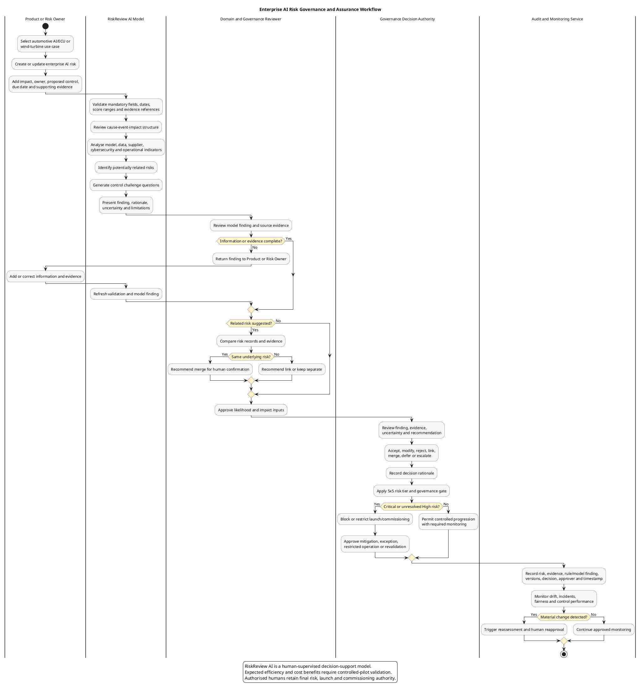

# RiskReview AI - Initial Automotive Programme Risk Review Workflow

Paste the following PlantUML source into the official PlantUML Web Server and export the result as PNG or SVG.

## Repository placement

- Source: `04_UX_Workflow_Trust/01_Initial_Workflow_PlantUML.md`
- Rendered image: `04_UX_Workflow_Trust/Images/01_Initial_Workflow_PlantUML.png`
