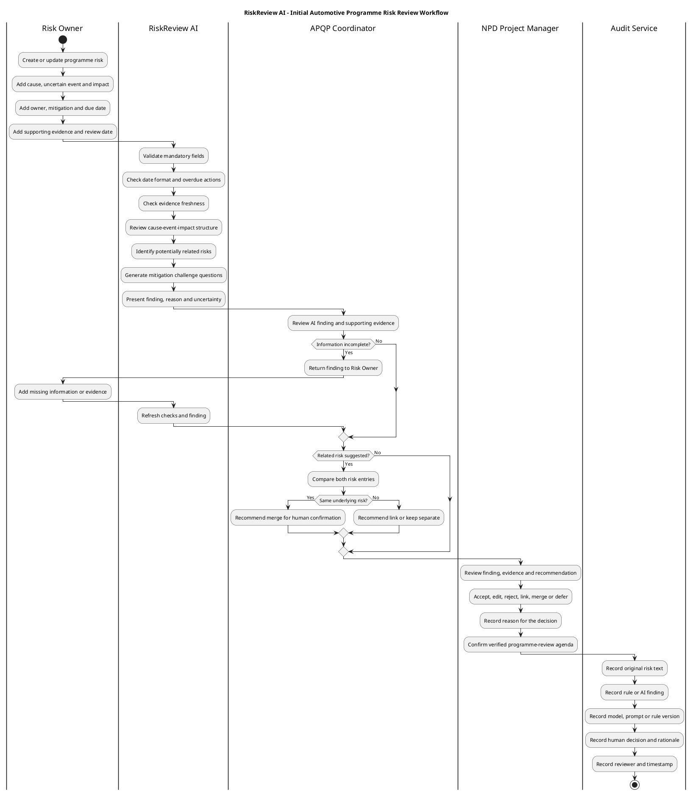

# Initial Workflow: PlantUML Swimlane

## Purpose

This document defines the initial workflow for **RiskReview AI** in an automotive component New Product Development and New Product Introduction programme.

The workflow covers the monthly programme-risk and launch-readiness review from **Advanced Product Quality Planning (APQP) to Start of Production**. It separates the responsibilities of the Risk Owner, RiskReview AI, APQP Coordinator, NPD Project Manager and Audit Service.

> **Status:** Initial workflow. The team will revise this workflow after discovery interviews, PRD validation and prototype usability testing.

## PlantUML Swimlane

## Workflow Explanation

### 1. Risk creation or update

The Risk Owner creates or updates a programme risk using the agreed automotive risk-register format. The entry should include the cause, uncertain event, impact, owner, mitigation, due date, review date and supporting evidence.

### 2. Deterministic validation

RiskReview AI first applies deterministic checks for objective conditions such as:

- Missing mandatory fields
- Invalid dates
- Overdue actions
- Missing ownership
- Evidence older than the configured review period

These checks do not require generative AI.

### 3. AI-assisted review

The product then supports semantic review by:

- Checking whether the risk statement contains a clear cause, uncertain event and impact
- Suggesting potentially related risks
- Generating questions that challenge vague or weak mitigation actions
- Explaining why a finding was raised
- Showing uncertainty rather than presenting an inference as a confirmed fact

### 4. APQP Coordinator review

The APQP Coordinator reviews the finding and the supporting evidence. If information is incomplete, the finding is returned to the Risk Owner for correction. The system refreshes the finding after the missing information is added.

### 5. Related-risk decision

When two risks appear related, the APQP Coordinator compares both entries. RiskReview AI may recommend a merge, link or separate treatment, but the product does not execute the decision automatically.

### 6. NPD Project Manager decision

The NPD Project Manager remains accountable for the final programme-risk decision. Available actions are:

- Accept
- Edit
- Reject
- Link
- Merge
- Defer

The decision reason must be recorded. RiskReview AI cannot automatically assign probability or impact, approve PPAP, approve Start of Production, or close a programme risk.

### 7. Audit record

The Audit Service records:

- Original risk text
- Finding type and explanation
- Rule, model or prompt version
- Human decision
- Decision rationale
- Reviewer
- Timestamp

This supports traceability, contestability and later evaluation.

## Human-in-the-Loop Boundary

RiskReview AI provides review support only. Authorised humans remain responsible for:

- Risk meaning
- Probability and impact
- Mitigation selection
- Risk ownership
- Escalation
- Acceptance
- Linking or merging
- Closure
- PPAP and Start-of-Production decisions

## Manual Fallback

If the AI service is unavailable or the output is unreliable:

1. Deterministic completeness and date checks should continue where possible.
2. The APQP Coordinator should use the standard manual review checklist.
3. No AI finding should be treated as confirmed without human review.
4. The outage and any delayed reviews should be recorded.

## Items Requiring Validation

The following remain provisional until discovery and prototype testing:

- Mandatory fields for each customer
- Evidence-age threshold
- Similarity threshold for related-risk suggestions
- Escalation roles
- Review sequence
- Audit-retention period
- Customer-specific APQP milestones
- Integration with customer systems
